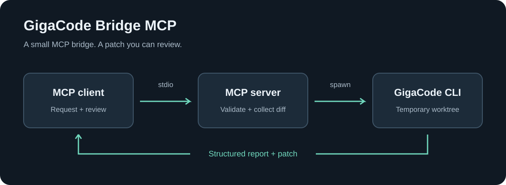
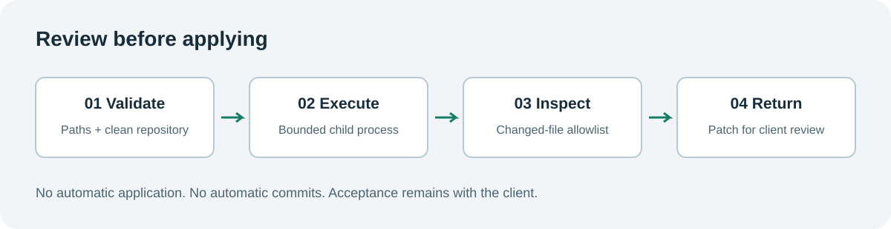

# GigaCode Bridge MCP



A small Go MCP server that runs bounded GigaCode CLI tasks in temporary Git worktrees and returns patches for review. Uses stdio, with no HTTP service or database.

## Requirements

- macOS or Linux with Git on PATH. Go 1.25+ is needed only for building.
- An installed, authenticated GigaCode CLI with access to its configured provider.
- An MCP client that supports stdio.
- A clean Git repository with an existing commit.

Local operation and a real delegated documentation edit have been verified on macOS. Linux and remote SSH transport remain unverified.

## Install

Choose a binary matching your OS and CPU if one has been provided, place it at `~/.local/bin/gigacode-bridge-mcp`, and make it executable with `chmod +x ~/.local/bin/gigacode-bridge-mcp`. No Go toolchain is needed to run it. Register that absolute path as the MCP command.

To build from source:

```sh
git clone https://github.com/grishingrishin/gigacode-bridge-mcp.git
cd gigacode-bridge-mcp
go mod download
go build -o bin/gigacode-bridge-mcp .
```

The default executable is `~/.gigacode/bin/gigacode`, resolved using the server account's home directory. Set `GIGACODE_BIN` to an absolute executable path for a different installation.

## Connect locally

For Codex, run this from the installation directory:

```sh
codex mcp add gigacode-bridge-mcp -- "$PWD/bin/gigacode-bridge-mcp"
codex mcp get gigacode-bridge-mcp
```

Use `make setup` to configure Codex automatically. Restart the client and inspect its MCP tool list. The exposed tool is `delegate_task`.

Other MCP clients can launch `/absolute/path/gigacode-bridge-mcp` using stdio. Standard output is reserved for protocol messages.

## Connect over SSH

Copy the binary built for the execution host and install Git and GigaCode there. Node.js is not required by the MCP server; GigaCode may have its own runtime requirements. Enable key-based SSH authentication and verify its host key through your normal SSH setup.

An example Codex configuration is:

```toml
[mcp_servers.gigacode-bridge-mcp]
command = "ssh"
args = [
  "-T",
  "-o", "BatchMode=yes",
  "-o", "ConnectTimeout=10",
  "mcp-host",
  "/absolute/path/to/gigacode-bridge-mcp"
]
```

Replace the host alias and executable paths. Use fixed paths without spaces or shell metacharacters in the SSH command. Use an absolute binary path and ensure Git is on the remote PATH. Ensure shell startup scripts do not print banners to stdout.

SSH starts the MCP process; the MCP process starts GigaCode on demand. Neither needs a manually opened interactive session. A process manager or HTTP listener is unnecessary.

The repository must already exist on the execution host. File arguments refer to that host's canonical absolute paths. This server does not synchronize repositories. Before applying a returned patch elsewhere, compare the report's baseCommit with the receiving repository and run `git apply --check`.

## Tool contract

| Parameter | Type | Constraint |
| --- | --- | --- |
| task | string | 1-12,000 characters |
| files | string[] | 1-30 canonical absolute paths |
| acceptanceCriteria | string[] | 1-20 nonempty criteria |
| timeoutSec | integer | Validated by the server |

All files must be existing, tracked regular files in one clean repository. Symbolic-link paths, parent traversal, new files and dirty repositories are unsupported. On macOS, resolve aliases such as /tmp to canonical paths before calling.

```json
{
  "task": "Add a concise JSDoc comment to the exported function without changing behavior.",
  "files": ["/absolute/path/project/src/example.js"],
  "acceptanceCriteria": [
    "Document parameters and return value",
    "Preserve the function signature and implementation"
  ],
  "timeoutSec": 120
}
```

A successful response contains:

- status: review_required
- repository and baseCommit
- changedFiles and patch
- summary, applied: false, and a reminder to verify acceptance independently

Errors return an MCP error result with a structured code and no accepted patch. Examples include timeout, output_limit, invalid_path, dirty_repository and allowlist_violation.

## Review workflow



The client reviews every diff, verifies the criteria independently and decides whether to apply the patch. A GigaCode summary is not evidence of correctness. Save an accepted patch and run:

```sh
git apply --check /path/to/review.patch
git apply /path/to/review.patch
```

The server never applies patches to the source checkout or creates commits. A portable optional Codex skill is provided in `skills/delegate-to-gigacode/SKILL.md`; copy its directory into your client's skills directory.

## Boundaries

- Child arguments use os/exec without a shell.
- Combined child output is limited to 1 MiB; each Git command has the same output bound.
- Timeout, cancellation and excess output trigger process-group termination.
- Execution and cleanup are bounded internally.
- Only one task runs per server process.
- Final tracked, untracked and ignored changes are checked against the allowlist.
- Symbolic-link outputs and changes to HEAD are rejected.
- A detached worktree is removed after execution, including ordinary failures.
- Raw stderr and credential files are not returned. Patches and summaries contain task data and must be handled accordingly.

A worktree is Git isolation, not an OS sandbox. The process has the execution account's filesystem permissions and shares Git metadata. The allowlist detects final changes inside the worktree, not attempted or reverted writes or changes elsewhere. Use trusted repositories and tasks. Crashes or forced server termination can leave worktrees behind; inspect `git worktree list` before manual cleanup.

## Troubleshooting

If delegation is unavailable, the primary agent should continue the task directly. No additional setup or manual checks are required for normal use.

For connection problems, run `./bin/gigacode-bridge-mcp --check`. Confirm that Git and the authenticated GigaCode CLI are available to the account running the server.

[Developer diagnostics and verification](development.md) describes optional tests and implementation details.

## References

- [Official MCP Go SDK](https://github.com/modelcontextprotocol/go-sdk)
- [Codex MCP configuration](https://developers.openai.com/codex/mcp)

## Cross-compilation

```sh
CGO_ENABLED=0 GOOS=linux GOARCH=amd64 go build -o bin/gigacode-bridge-mcp-linux-amd64 .
CGO_ENABLED=0 GOOS=linux GOARCH=arm64 go build -o bin/gigacode-bridge-mcp-linux-arm64 .
CGO_ENABLED=0 GOOS=darwin GOARCH=arm64 go build -o bin/gigacode-bridge-mcp-darwin-arm64 .
CGO_ENABLED=0 GOOS=darwin GOARCH=amd64 go build -o bin/gigacode-bridge-mcp-darwin-amd64 .
```

Use the binary matching the host OS and CPU. Windows is not supported by the POSIX process-group implementation. Cross-compilation is not runtime verification.
